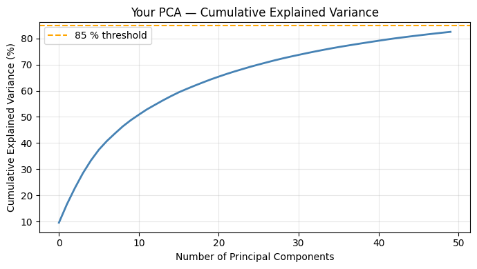
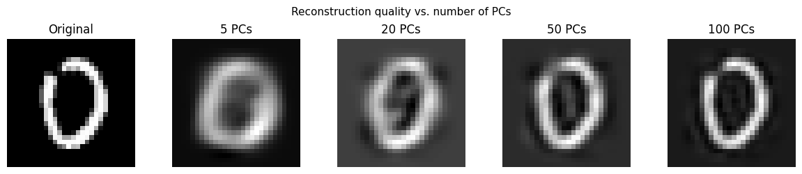
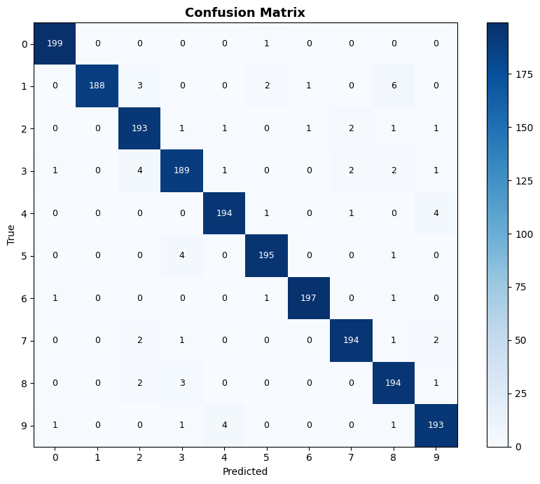
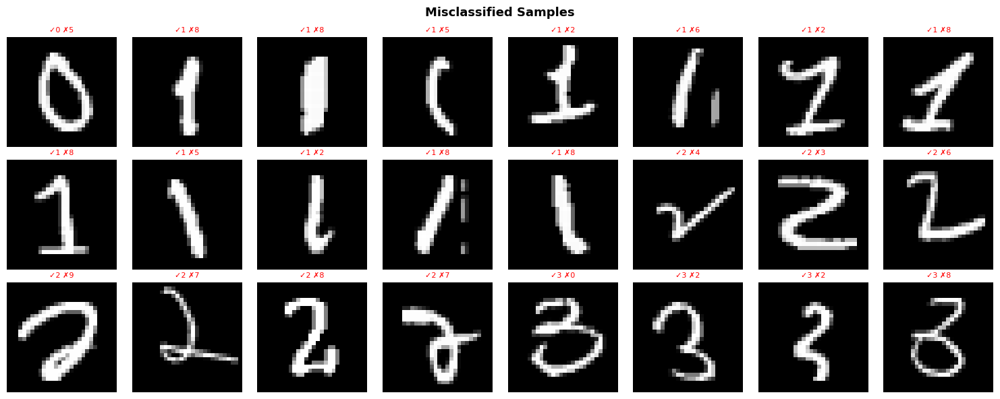
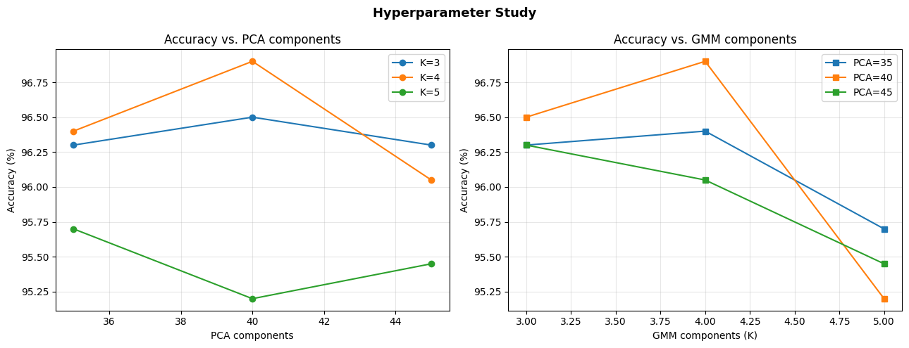

# MNIST Classification with PCA and Gaussian Mixture Models

A handwritten digit classification project using **Principal Component Analysis (PCA)** for dimensionality reduction and **Gaussian Mixture Models (GMMs)** for probabilistic classification. Core PCA, K-Means, Gaussian density, expectation-maximization and classifier logic are implemented with NumPy, with scikit-learn used for dataset loading and evaluation.

> **Project context:** This notebook includes assignment instructions, scaffold, code, experiments, and written reflections. Adapt the authorship/contribution statement below to accurately reflect the work you completed.

## Results at a glance

| Experiment | Accuracy |
|---|---:|
| K-Means nearest centroid (K=1) | 78.8% |
| K-Means classifier (K=4) | 87.7% |
| Main full-covariance GMM classifier (40 PCA components, 4 mixture components) | **96.80%** |
| Best configuration in the hyperparameter study (40 PCA components, K=4) | **96.90%** |
| Diagonal-covariance GMM bonus experiment | 91.10% |

The main evaluation uses **10,000 training images** and **2,000 test images**, with 1,000 training and 200 test images for each digit class. The main GMM classifier correctly classified **1,936 of 2,000** test images (64 errors). The grid-search result is a separate run; it should not be confused with the main evaluation.

## Approach

1. **Data preparation:** Load the MNIST dataset through OpenML, scale pixel values to [0, 1], and create a class-balanced train/test subset.
2. **PCA from scratch:** Compute the feature mean, covariance matrix and eigendecomposition; project images into a lower-dimensional space and reconstruct them to study lost information.
3. **K-Means baseline:** Cluster digit examples and predict using nearest class centroids.
4. **GMM from scratch:** Implement multivariate Gaussian log-density and the expectation-maximization (EM) algorithm, including numerical stabilization.
5. **Generative classification:** Train a separate GMM for each digit and predict classes using log-likelihoods and class priors.
6. **Evaluation:** Compare accuracy, examine class-level performance and errors, plot convergence, and run a PCA/GMM hyperparameter study.
7. **Bonus experiment:** Compare a diagonal-covariance GMM against a full-covariance model.

## Visual results

### PCA explained variance

With **50 PCA components**, the notebook reports **82.5%** explained variance.



### Reconstructing digits from PCA features

Reconstruction improves as more principal components are retained.



### Classification confusion matrix

The main GMM evaluation achieved **96.80%** test accuracy.



### Misclassified digit examples

The notebook reports **64 misclassified images** from the 2,000-image test set.



### Hyperparameter comparison

The grid explored **35, 40, 45 PCA components** and **3, 4, 5 mixture components**. Its best recorded result was **96.90%**, at 40 PCA components and four GMM components.



More figures (PCA projection, learned GMM means, and EM convergence) are available in [`results/`](results/).

## Tools and dependencies

- Python and Jupyter/Google Colab
- NumPy for mathematical implementations
- Matplotlib for plots
- scikit-learn for fetching MNIST and calculating evaluation metrics
- SciPy for a reference-check in a notebook validation cell

## Run the notebook

1. Open [`notebooks/MNIST_PCA_GMM.ipynb`](notebooks/MNIST_PCA_GMM.ipynb) in Google Colab or Jupyter.
2. Install dependencies from `requirements.txt` if running locally.
3. Run notebook cells from top to bottom. The `fetch_openml` step requires an internet connection and downloads the MNIST dataset.
4. Training the many GMM configurations can take time; actual outputs may vary between reruns or environments.

## Repository structure

```text
MNIST-Classification-PCA-GMM/
├── README.md
├── requirements.txt
├── .gitignore
├── notebooks/
│   └── MNIST_PCA_GMM.ipynb
└── results/
    ├── confusion_matrix.png
    ├── hyperparameter_study.png
    └── ... additional saved figures
```

## Limitations and possible extensions

- Results use a class-balanced subset of MNIST rather than the standard full 60,000/10,000 train/test split.
- GMM performance and cost depend on PCA dimensions, covariance assumptions, component count and initialization.
- The handwritten digits are flattened for PCA, losing some direct spatial structure.
- Possible extensions: repeated-seed evaluation, full MNIST testing, computational profiling, or a CNN comparison.

## Contribution and acknowledgements

**Before publishing:** Specify which notebook sections you implemented yourself, acknowledge any course-provided scaffold, and check that your course permits making the material public. Replace this paragraph with your own accurate contribution statement.
